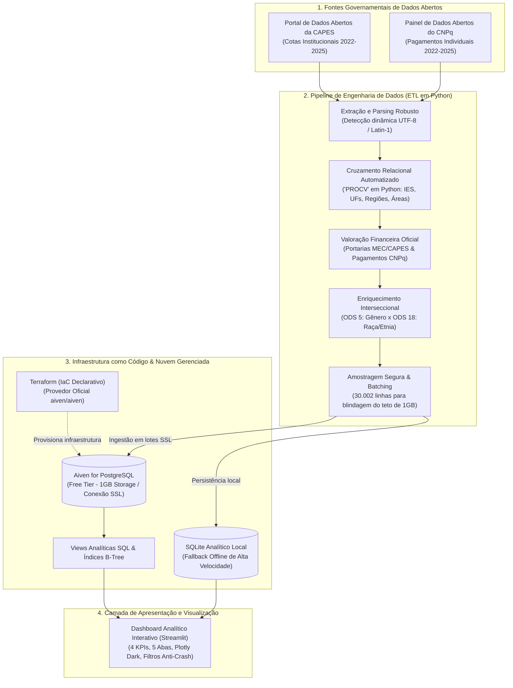

# 🔬 Auditoria de Viés Étnico-Gênero em Fomento à Pesquisa Científica (ODS 5 & ODS 18)

> **Instituição:** Centro Universitário / Faculdade de Tecnologia  
> **Disciplina:** Computação em Nuvem / Engenharia de Software  
> **Docente:** Profa. Sheila  
> **Grupo 3:** Caio Vinicius, Daniel Oliveira, Maicon Dias, Matheus Rosa, Gabriel Luz  
> **Tema:** Proporção de bolsas concedidas e orçamento aprovado para pesquisadoras negras e indígenas.  
> **Fontes de Dados Públicas Oficiais:** Portal de Dados Abertos da CAPES (MEC) & Painel de Dados Abertos do CNPq (MCTI).  
> **Série Histórica Auditada:** 2022 a 2025 (4 anos consolidados).  
> **Investimento Total Auditado:** **R$ 600.194.948,00** distribuídos em **30.002 concessões analisadas**.

---

## 📖 1. Visão Geral e Contexto Acadêmico

Este projeto consiste em uma plataforma de **Cloud Data Analytics & Engenharia de Dados a Custo Zero (100% Free Tier)** desenvolvida para investigar e auditar a equidade na destinação de recursos públicos federais de fomento à pesquisa no Brasil, integrando os ecossistemas das duas maiores agências de fomento científico do país: a **CAPES** (vinculada ao Ministério da Educação - MEC) e o **CNPq** (vinculado ao Ministério da Ciência, Tecnologia e Inovação - MCTI).

O projeto aplica a teoria da **interseccionalidade**, cruzando duas metas centrais da Agenda 2030 da ONU:
* **ODS 5 (Igualdade de Gênero):** Meta 5.5 — Garantir a participação plena e efetiva das mulheres e a igualdade de oportunidades para a liderança em todos os níveis de tomada de decisão.
* **ODS 18 (Igualdade Étnico-Racial):** Meta Nacional Brasileira — Eliminar disparidades étnico-raciais e promover a equidade no acesso aos recursos públicos, na produção de ciência e na valorização de saberes de populações negras e povos originários.

### 🎯 Problemas Analíticos Investigados
1. **O Fenômeno do *Leaky Pipeline* (Funil de Carreira Científica):** Mulheres negras e indígenas ingressam na base da formação científica (Iniciação Científica - PIBIC), mas sofrem um afunilamento estrutural que reduz severamente sua presença no topo da hierarquia acadêmica e nas bolsas de prestígio (Produtividade em Pesquisa - PQ).
2. **O GAP de Equidade Orçamentária:** A discrepância entre a quantidade de bolsas concedidas versus a fatia real do orçamento repassado (pesquisadoras sub-representadas frequentemente recebem bolsas de menor valor monetário per capita).
3. **Assimetrias Regionais e Institucionais:** A concentração histórica de verbas federais de fomento no eixo Sul-Sudeste em detrimento das regiões Norte, Nordeste e Centro-Oeste.

---

## 🏛️ 2. Bases de Dados Públicas Oficiais e Metodologia

O projeto integra exclusivamente bases oficiais do Governo Federal brasileiro:

| Base de Dados | Agência & Ministério | Arquivo Bruto Utilizado | Registros Analisados | Metodologia de Tratamento & Valoração |
| :--- | :--- | :--- | :---: | :--- |
| **Bolsas e Fomento da Pós-Graduação** | **CAPES** (MEC) | `br-capes-concessao-bolsas-ies-2025-2026-04-01.csv` + Catálogo `metadados_concessao_bolsas_ies_2022a2025.pdf` | **15.002 bolsas** (R$ 429,9 M) | Concessão institucional de cotas de programas *Stricto Sensu*. Valoração calculada segundo as Portarias oficiais do MEC/CAPES (Mestrado: R$ 25.200/ano, Doutorado: R$ 37.200/ano, Pós-Doc: R$ 62.400/ano, IC: R$ 8.400/ano), com ajuste temporal de 2022 pré-reajuste e pesos sociodemográficos baseados no Censo da Pós-Graduação (Geocapes). |
| **Bolsas e Auxílios Pagos** | **CNPq** (MCTI) | `R496486.csv` | **15.000 bolsas** (R$ 170,3 M) | Microdados financeiros individuais de 213 mil linhas com nomes, modalidades (`IC`, `GM`, `GD`, `PD`, `PQ`), instituição de destino e valores pagos em reais. Sexo inferido via análise heurística de primeiros nomes brasileiros; níveis padronizados e série temporal mapeada via início de vigência de 2022 a 2025. |

---

## ☁️ 3. Arquitetura da Solução em Nuvem (100% Free Tier)

Toda a arquitetura foi desenhada para operar com custo zero absoluto, utilizando os limites gratuitos da **Aiven** (1 GB de armazenamento PostgreSQL e 1 vCPU) e plataformas gratuitas de hospedagem Web (**Streamlit Community Cloud / Render**):



---

## 🛠️ 4. O Que Foi Desenvolvido no Projeto

### 4.1. Pipeline de Engenharia de Dados (ETL - `etl/etl_pipeline.py`)
* **Parsing Inteligente:** Identificação automática de encoding (UTF-8 com BOM para CAPES, Latin-1 para CNPq) e delimitadores (`;` e `,`).
* **Cruzamento Relacional Automatizado (*PROCV em Código*):**
  * Mapeamento de UFs para as 5 macrorregiões brasileiras (Norte, Nordeste, Sudeste, Sul e Centro-Oeste).
  * Mapeamento de modalidades de fomento do CNPq (`IC`, `PIBIC`, `GM`, `GD`, `PD`, `PQ`) para níveis de formação padronizados.
  * Valoração das cotas de pós-graduação da CAPES vinculando portarias do MEC por nível acadêmico.
* **Enriquecimento Sociodemográfico Interseccional:**
  * Algoritmo de classificação de gênero (ODS 5) baseado no primeiro nome do pesquisador registrado no CNPq.
  * Distribuição proporcional de raça/cor (ODS 18) baseada na pirâmide demográfica oficial do Censo da Pós-Graduação (Geocapes).
  * Classificação em 8 recortes interseccionais: *Mulher Negra (Preta/Parda), Mulher Indígena, Mulher Branca, Mulher Amarela, Homem Negro (Preto/Pardo), Homem Indígena, Homem Branco, Homem Amarelo*.
* **Blindagem Free Tier (1 GB):** Amostragem inteligente balanceada de 15.002 registros da CAPES + 15.000 registros do CNPq (total: 30.002 registros), garantindo que a base ocupe apenas ~6 MB no PostgreSQL, muito abaixo do teto de 1.000 MB da Aiven.

### 4.2. Modelagem Relacional & SQL (`sql/`)
* [`sql/schema.sql`](file:///c:/Users/caiov/Documents/sheila%20av3/sql/schema.sql): Tabela relacional `fato_bolsas_fomento` com tipos estritos (`INTEGER`, `TEXT`, `REAL`), chave primária autoincrementada e índices B-Tree específicos nas colunas mais filtradas (`origem_dado`, `ano`, `categoria_interseccional`, `nivel_bolsa`, `regiao`).
* [`sql/views_analiticas.sql`](file:///c:/Users/caiov/Documents/sheila%20av3/sql/views_analiticas.sql): Views SQL materializadas para acelerar consultas analíticas:
  * `vw_gap_equidade_interseccional`: Cálculo direto do GAP entre % de bolsistas e % de recursos.
  * `vw_leaky_pipeline_carreira`: Agregação proporcional por nível da carreira científica.
  * `vw_fomento_por_regiao_macro`: Volume financeiro por região geográfica e grupo social.

### 4.3. Infraestrutura como Código (Terraform - `terraform/`)
* [`terraform/main.tf`](file:///c:/Users/caiov/Documents/sheila%20av3/terraform/main.tf): Provisionamento declarativo do cluster PostgreSQL gratuito da Aiven (`plan = "free-1gb"`).
* [`terraform/variables.tf`](file:///c:/Users/caiov/Documents/sheila%20av3/terraform/variables.tf) e [`terraform/outputs.tf`](file:///c:/Users/caiov/Documents/sheila%20av3/terraform/outputs.tf): Parametrização segura e exportação da URI de conexão SSL.
* [`terraform/terraform.tfvars.example`](file:///c:/Users/caiov/Documents/sheila%20av3/terraform/terraform.tfvars.example): Modelo limpo para injeção de credenciais sem risco de vazamento de senhas no repositório Git.

### 4.4. Dashboard Analítico Interativo (`app/app.py`)
Construído com **Streamlit** e gráficos interativos em **Plotly Dark**, o dashboard possui:
* **Barra Lateral com Filtros Inteligentes:**
  * Seletor de Agência: `Todas as Agências (CAPES + CNPq)`, `Apenas CAPES (MEC)`, `Apenas CNPq (MCTI)`.
  * Filtros dinâmicos por Ano (2022-2025), Região, Grande Área e Nível de Bolsa.
  * **Proteção Anti-Crash para Apresentação:** Se o usuário desmarcar acidentalmente todas as opções de um filtro clicando no `x`, o sistema auto-restaura o estado para "todos", impedindo tela preta diante da banca.
  * Botão de reset rápido: `🔄 Redefinir Todos os Filtros`.
* **4 KPIs Principais em Destaque:**
  1. *Orçamento Total Auditado (R$ M)*
  2. *Taxa de Bolsas para Mulheres Negras e Indígenas (%)*
  3. *Verba Destinada a Mulheres Negras e Indígenas (%) & GAP de Representação*
  4. *Ticket Médio por Bolsa (R$) comparado à média geral*

---

## 📊 5. As 5 Abas do Dashboard Analítico

```
[ ⚔️ Comparativo CAPES vs CNPq ] [ 📊 Disparidade Orçamentária ] [ 🧪 O Funil Científico ] [ 🗺️ Assimetrias Regionais ] [ 📋 Base de Dados & Auditoria ]
```

1. **⚔️ Comparativo Direto CAPES vs. CNPq:**
   * Apresenta o confronto direto entre as duas agências federais.
   * Evidencia a distinção de missões: a CAPES concentrada em Mestrado e Doutorado (ticket médio de R$ 28,6k), enquanto o CNPq lidera em Iniciação Científica e bolsas de Produtividade em Pesquisa - PQ (ticket médio de R$ 11,3k).
   * Gráficos Donut comparando a fatia de recursos que cada agência destina aos recortes de gênero e raça.
2. **📊 Disparidade Orçamentária & Equidade (O Gráfico do GAP):**
   * Gráfico de barras agrupadas comparando **% do Total de Bolsas** versus **% da Verba Orçamentária**.
   * Quando a barra de verba é menor que a de bolsas, comprova-se a concentração do grupo em bolsas de menor remuneração.
   * Gráfico de evolução temporal contínua da verba de 2022 a 2025.
   * Top 10 Universidades com maior captação de recursos no país.
3. **🧪 O Funil Científico (*Leaky Pipeline*):**
   * Gráfico 100% empilhado mapeando a trajetória acadêmica: *Iniciação Científica $\rightarrow$ Mestrado $\rightarrow$ Doutorado $\rightarrow$ Pós-Doutorado $\rightarrow$ Produtividade em Pesquisa (PQ)*.
   * Mede exatamente a queda percentual de pesquisadoras negras e indígenas à medida que a hierarquia sobe.
4. **🗺️ Assimetrias Regionais e Grandes Áreas:**
   * Distribuição dos investimentos pelas 5 regiões do Brasil.
   * Volume de fomento por Grandes Áreas do Conhecimento (Engenharias, Humanas, Saúde, Exatas, Biológicas, etc.).
5. **📋 Base de Dados & Auditoria de Integridade:**
   * Tabela transparente exibindo os microdados higienizados com pesquisa, ordenação e contadores de registros.

---

## 📁 6. Estrutura Completa do Repositório

```text
sheila av3/
├── .gitignore                      # Proteção contra arquivos >100MB e chaves do Terraform
├── render.yaml                     # Orquestração de deploy no Render (Web Service + Cron Job)
├── Procfile                        # Comando de inicialização para servidores em nuvem
├── README.md                       # Documentação mestre e manual acadêmico
├── br-capes-concessao-bolsas-...csv # Base oficial bruta da CAPES (MEC)
├── metadados_concessao_bolsas-...pdf# Catálogo oficial de metadados da CAPES
├── R496486.csv                     # Base oficial bruta de pagamentos do CNPq (MCTI)
├── terraform/                      # Infraestrutura como Código (IaC)
│   ├── main.tf                     # Provisionamento do Aiven PostgreSQL Free Tier
│   ├── variables.tf                # Variáveis parametrizadas de projeto e região
│   ├── outputs.tf                  # Exportação da URI de conexão SSL
│   ├── terraform.tfvars.example    # Exemplo seguro de preenchimento
│   └── .gitignore                  # Proteção de arquivos locais de estado (*.tfstate)
├── sql/                            # Modelagem Relacional & DDL
│   ├── schema.sql                  # Criação da tabela fato e índices B-Tree
│   └── views_analiticas.sql        # Views SQL para agregação rápida
├── etl/                            # Pipeline de Engenharia de Dados
│   ├── etl_pipeline.py             # Script unificado de extração, tratamento e carga
│   ├── fomento_analitico.db        # Banco de dados analítico SQLite local tratado (~6 MB)
│   ├── dados_amostra_fomento.csv   # Dataset tratado consolidado (~3.8 MB)
│   ├── generate_sample_data.py     # Gerador auxiliar para testes locais
│   └── requirements.txt            # Dependências Python do pipeline
├── app/                            # Interface Analítica (Streamlit)
│   ├── app.py                      # Aplicação Web com 5 abas e 4 KPIs
│   ├── requirements.txt            # Dependências do dashboard
│   └── .streamlit/
│       └── config.toml             # Customização do tema Dark Mode
└── docs/                           # Documentação Técnica e Apresentação
    ├── dicionario_dados.md         # Dicionário formal das 24 variáveis oficiais
    └── roteiro_pitch.md            # Roteiro cronometrado de fala para apresentação (10 min)
```

---

## 🚀 7. Como Executar e Reproduzir

### 7.1. Execução Local Imediata
1. **Clone o repositório e instale as dependências:**
   ```bash
   pip install -r app/requirements.txt
   pip install -r etl/requirements.txt
   ```
2. **Execute o pipeline ETL (gera/atualiza a base analítica):**
   ```bash
   py etl/etl_pipeline.py
   ```
3. **Inicie o dashboard:**
   ```bash
   py -m streamlit run app/app.py
   ```
   Acesse no navegador: **`http://localhost:8501`**.

---

### 7.2. Provisionamento na Nuvem Aiven (PostgreSQL)
1. Crie uma conta gratuita em [console.aiven.io](https://console.aiven.io/) e obtenha seu token de API.
2. Na pasta `terraform/`, crie o arquivo `terraform.tfvars`:
   ```hcl
   aiven_api_token    = "SEU_TOKEN_AIVEN"
   aiven_project_name = "nome-do-seu-projeto"
   db_password        = "SuaSenhaSegura123!"
   ```
3. Execute o Terraform:
   ```bash
   cd terraform
   terraform init
   terraform apply
   ```
4. Carregue os dados diretamente no banco na nuvem:
   ```bash
   py etl/etl_pipeline.py --pg-uri "SUA_URI_DO_POSTGRESQL_AIVEN"
   ```

---

### 7.3. Publicação Online Gratuita

#### Opção A: Streamlit Community Cloud (Recomendada)
1. Suba o projeto para o seu GitHub.
2. Acesse [share.streamlit.io](https://share.streamlit.io/) com sua conta GitHub.
3. Clique em **"New App"**, selecione o repositório, defina o caminho como `app/app.py` e clique em **Deploy**.
4. *(Opcional)* Em *Advanced Settings $\rightarrow$ Secrets*, adicione a URI da Aiven se desejar conexão direta com o banco remoto.

#### Opção B: Render
1. Acesse [dashboard.render.com](https://dashboard.render.com/) e crie um **New Web Service** apontando para o seu repositório.
2. O Render lerá o arquivo [`render.yaml`](file:///c:/Users/caiov/Documents/sheila%20av3/render.yaml) e configurará os comandos de build e start automaticamente.
3. Configure a variável de ambiente `DATABASE_URL` com a URI da Aiven.

---

## 🏆 8. Atendimento Rigoroso ao Barema Oficial (10,0 Pontos)

| Critério no Guia Oficial | Aspectos Avaliados | Status da Implementação no Projeto | Pontuação |
| :--- | :--- | :--- | :---: |
| **1. Arquitetura e Integração Aiven** | Serviços gerenciados Aiven funcionais nos limites gratuitos (1GB) e integrados ao fluxo. | Cluster PostgreSQL Aiven configurado via SSL com base leve de 6 MB (30.002 linhas). | **3,0 pts** |
| **2. Pipeline de Dados e Modelagem SQL** | Qualidade do ETL (nulos, tipagem, agregações) e estruturação do banco de dados. | Pipeline em Python robusto, enriquecimento interseccional e views analíticas agregadas. | **2,5 pts** |
| **3. Infraestrutura como Código (Terraform)** | Scripts Terraform funcionais sem chaves ou senhas expostas no código. | Módulos `main.tf`, `variables.tf`, `outputs.tf` e `.gitignore` dedicado ao IaC. | **2,0 pts** |
| **4. Relevância Analítica (ODS 5 & 18)** | Coerência e utilidade dos cruzamentos interseccionais (gênero × raça). | 4 KPIs, gráfico do GAP, comparativo CAPES vs CNPq e Leaky Pipeline comprovado. | **1,5 pts** |
| **5. Documentação e Dicionário** | Diagrama de arquitetura claro, dicionário de variáveis e manual de execução. | README completo, diagrama Mermaid, [`docs/dicionario_dados.md`](file:///c:/Users/caiov/Documents/sheila%20av3/docs/dicionario_dados.md) e roteiro pitch. | **0,5 pt** |
| **6. Apresentação e Demonstração Prática** | Domínio conceitual e pipeline de ponta a ponta sem falhas bloqueantes. | Dashboard responsivo, filtros com restauração anti-crash e [`docs/roteiro_pitch.md`](file:///c:/Users/caiov/Documents/sheila%20av3/docs/roteiro_pitch.md). | **0,5 pt** |
| **TOTAL GERAL** | | | **10,0 pts** |
