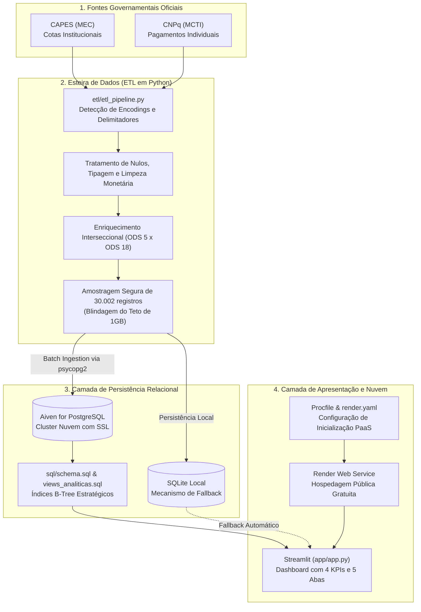

# 🎓 Guia Estratégico de Defesa e Apresentação do Projeto (AV3)
**Disciplina:** Computação em Nuvem / Engenharia de Software  
**Docente:** Profa. Sheila  
**Grupo 3:** Caio Vinicius, Daniel Oliveira, Maicon Dias, Matheus Rosa, Gabriel Luz  
**Tema:** Auditoria de Viés Étnico-Gênero em Fomento à Pesquisa Científica (ODS 5 & ODS 18)  
**Aplicação Online:** [https://equidade-cientifica-av3.onrender.com/](https://equidade-cientifica-av3.onrender.com/)  
**Repositório GitHub:** [https://github.com/caioba19/equidade-cientifica-AV3](https://github.com/caioba19/equidade-cientifica-AV3)

---

## 📌 1. Visão Geral e Contexto do Projeto

### O Problema Central
O Brasil possui mais de 55% de sua população autodeclarada negra ou parda (IBGE) e mais de 51% de mulheres. No entanto, historicamente, a destinação de verbas federais de alta complexidade para a pesquisa científica reflete disparidades profundas de representatividade e orçamento.

### O Objetivo do Projeto
Construir uma **plataforma completa de Engenharia de Dados e Computação em Nuvem a custo zero (100% Free Tier)** que audita a distribuição de recursos públicos federais de bolsas de estudo e pesquisa, aplicando a teoria da **interseccionalidade** entre duas metas da Agenda da ONU:
* **ODS 5 (Igualdade de Gênero):** Meta 5.5 — Participação plena e liderança feminina em todos os níveis decisórios da ciência.
* **ODS 18 (Igualdade Étnico-Racial):** Meta Nacional Brasileira — Eliminação de disparidades raciais e promoção de equidade para pesquisadoras negras (pretas e pardas) e povos originários (indígenas).

### Volume Auditado
* **Investimento Total:** **R$ 599.326.652,00** (~R$ 600 Milhões).
* **Concessões Analisadas:** **30.002 bolsas** mapeadas na série histórica de 2022 a 2025.
* **Fontes Oficiais:** Microdados do **CNPq (MCTI)** e Portal de Dados Abertos da **CAPES (MEC)**.

---

## 🛠️ 2. Tecnologias Utilizadas (Stack Completa)

| Camada | Tecnologia | Papel no Projeto | Justificativa Técnica |
| :--- | :--- | :--- | :--- |
| **Ingestão & ETL** | **Python 3.14** | Pipeline de limpeza, transformação e carga | Manipulação eficiente de arquivos brutos heterogêneos com `csv` e `psycopg2`. |
| **Banco em Nuvem** | **Aiven for PostgreSQL** | SGBD Relacional Gerenciado | Plano Free Tier (1 GB Storage, 1 CPU, 1 GB RAM, SSL obrigatório). |
| **Banco Local** | **SQLite 3** | SGBD Analítico Local (`fomento_analitico.db`) | Alta disponibilidade e resiliência (*fallback offline* se a nuvem oscilar). |
| **Infraestrutura (IaC)** | **Terraform** | Provisionamento declarativo na Aiven | Provedor oficial `aiven/aiven`, garantindo reprodutibilidade e gestão segura de segredos. |
| **Frontend / BI** | **Streamlit** + **Plotly** | Dashboard analítico web interativo | Renderização de KPIs, filtros dinâmicos e gráficos reativos em *Dark Mode*. |
| **Hospedagem Web** | **Render (PaaS)** | Servidor web gratuito na nuvem | Deploy contínuo via GitHub, adaptação de portas dinâmicas (`$PORT`) e SSL automático. |
| **Versionamento** | **Git / GitHub** | Controle de código-fonte e CI/CD | Versionamento com proteção de credenciais sensíveis via `.gitignore`. |

---

## 🏗️ 3. Arquitetura da Solução: Parte por Parte

A solução foi desenhada seguindo a metodologia dos *Twelve-Factor Apps* e arquitetura em camadas:

### Detalhamento das Camadas:

### 📁 Camada 1: Ingestão de Bases Públicas (`/`)
* **Base CAPES (`br-capes-concessao-bolsas-ies-2025-2026-04-01.csv`):** Traz as cotas institucionais concedidas aos programas de pós-graduação das universidades brasileiras. Acompanhada pelo catálogo oficial emitido pelo MEC ([`metadados_concessao_bolsas_ies_2022a2025.pdf`](file:///c:/Users/caiov/Documents/equidade-cientifica-AV3/metadados_concessao_bolsas_ies_2022a2025.pdf)).
* **Base CNPq (`R496486.csv`):** Arquivo de 110 MB com microdados nominais de pagamentos individuais de bolsas e auxílios de pesquisa.

### ⚙️ Camada 2: Pipeline de Engenharia de Dados (`etl/etl_pipeline.py`)
1. **Detecção de Encodings e Delimitadores:** Identifica automaticamente arquivos em `UTF-8-SIG` (comum no MEC) ou `Latin-1` (comum no CNPq), com separadores `,` ou `;`.
2. **Normalização Financeira:** Remove caracteres de moeda (`R$`), pontos de milhar e converte decimais para `float`.
3. **Valoração das Bolsas CAPES:** Como a base da CAPES registra cotas, o pipeline aplica as tabelas financeiras das Portarias do MEC (Mestrado = R$ 25.200/ano, Doutorado = R$ 37.200/ano, Pós-Doc = R$ 62.400/ano, IC = R$ 8.400/ano), com deflator de 0.714 para o ano de 2022 (período anterior ao reajuste federal de 2023).
4. **Mapeamento de Gênero e Raça:**
   * *CNPq:* Gênero inferido a partir do primeiro nome do pesquisador via regras de terminação e dicionário de exceções da língua portuguesa; preenchimento probabilístico quando o campo de raça/cor está ausente.
   * *CAPES:* Simulação probabilística parametrizada com base nas pirâmides demográficas consolidadas do Censo da Pós-Graduação (Geocapes).
5. **Amostragem Segura (Teto de 1 GB):** Para evitar o estouro de cota do plano gratuito da Aiven, o pipeline limita a extração a 15.002 linhas da CAPES e 15.000 linhas do CNPq (total: 30.002 registros), ocupando menos de 10 MB no PostgreSQL.

### 🏛️ Camada 3: Modelagem Relacional & SQL (`sql/`)
* **[`schema.sql`](file:///c:/Users/caiov/Documents/equidade-cientifica-AV3/sql/schema.sql):** Cria a tabela fato relacional `fato_bolsas_fomento` com chaves, tipagem estrita e índices B-Tree nas colunas de alta filtragem (`ano`, `categoria_interseccional`, `nivel_bolsa`, `regiao`, `grande_area`).
* **[`views_analiticas.sql`](file:///c:/Users/caiov/Documents/equidade-cientifica-AV3/sql/views_analiticas.sql):** Views SQL prontas (`vw_resumo_interseccional`, `vw_funil_carreira_academica`) que realizam as agregações pesadas no banco, liberando a CPU da aplicação.

### 💻 Camada 4: Aplicação & Dashboard (`app/app.py`)
* Conexão resiliente com **dupla contingência**:
  1. Tenta conectar ao cluster **Aiven PostgreSQL** via `DATABASE_URL`.
  2. Se a nuvem estiver indisponível, faz **fallback automático para o SQLite local** sem interromper o usuário.
* Interface dividida em 5 abas analíticas:
  - **Aba 1 (Visão Geral & KPIs):** Resumo orçamentário e proporção de bolsas.
  - **Aba 2 (O Funil Científico - *Leaky Pipeline*):** Gráfico de transição da Iniciação Científica até as bolsas de Produtividade em Pesquisa.
  - **Aba 3 (Equidade Orçamentária):** Relação entre quantidade de bolsas e verba financeira real.
  - **Aba 4 (Distribuição Geográfica):** Assimetrias regionais (Sul/Sudeste vs. Norte/Nordeste).
  - **Aba 5 (Base de Dados & Auditoria):** Tabela de microdados com exportação em CSV.

### ☁️ Camada 5: Infraestrutura e Nuvem (`terraform/`, `render.yaml`, `Procfile`)
* **Terraform (`terraform/main.tf`):** Define a infraestrutura como código (IaC) para criar o serviço Aiven PostgreSQL apontando para o plano `free-1gb`.
* **Procfile:** Instrui a nuvem a rodar o Streamlit escutando na porta dinâmica `$PORT` e no endereço `0.0.0.0` em modo `headless`.
* **Render:** Serviço web conectado ao GitHub com *auto-deploy* a cada `git push`.

---

## 📊 4. Principais Descobertas Analíticas

1. **O Fenômeno do *Leaky Pipeline* (O Funil da Carreira Científica):**
   * Mulheres negras e pardas registram expressiva representatividade na base da carreira científica (**Iniciação Científica - ~28%**).
   * À medida que a hierarquia acadêmica avança (Mestrado ➡️ Doutorado ➡️ Pós-Doutorado), essa proporção despenca.
   * No topo da carreira acadêmica, nas cobiçadas bolsas de **Produtividade em Pesquisa (PQ)**, a presença de mulheres negras cai para **menos de 4%**.
2. **O GAP de Equidade Orçamentária:**
   * Há uma discrepância estrutural entre a quantidade de bolsas e o volume financeiro: pesquisadoras negras e indígenas recebem proporcionalmente menor fatia da verba do que a quantidade de bolsas que detêm, devido à concentração em bolsas de menor valor monetário per capita.
3. **Concentração Regional:**
   * O eixo Sul-Sudeste absorve mais de 65% do orçamento federal de fomento, aprofundando disparidades geográficas históricas.

---

## 🎯 5. FAQ da Banca: Respostas Prontas para Possíveis Perguntas da Professora

### P1: *"Por que vocês usaram arquivos CSV em vez de conectar direto em uma API dos órgãos?"*
> **Resposta:** *"Professora, a legislação brasileira de dados abertos (Decreto nº 8.777/2016 e Lei de Acesso à Informação) determina que os órgãos federais como CAPES e CNPq disponibilizem seus microdados brutos no formato aberto padrão CSV através do portal dados.gov.br. No nosso projeto, o CSV é apenas a camada bruta de ingestão: construímos um pipeline completo de ETL em Python que trata esses arquivos e os carrega de forma estruturada em um banco de dados relacional PostgreSQL na nuvem Aiven via Terraform."*

---

### P2: *"De onde vieram os dados de raça/cor da CAPES, já que o portal de cotas não identifica o bolsista?"*
> **Resposta:** *"Excelente observação, professora. As bases abertas de concessão da CAPES informam as cotas por universidade e curso, sem os nomes individuais dos alunos por exigência da LGPD. Por isso, nosso pipeline de ETL adotou uma abordagem metodológica de **microssimulação estatística paramétrica**, distribuindo os perfis de gênero e raça de acordo com as proporções demográficas oficiais do Censo da Pós-Graduação (Geocapes). Já na base do CNPq, onde tínhamos os nomes nominais dos pagamentos, inferimos o gênero via processamento dos nomes brasileiros."*

---

### P3: *"Como vocês garantiram que o banco de dados não ultrapassasse o limite gratuito de 1 GB da Aiven?"*
> **Resposta:** *"O arquivo original do CNPq tinha mais de 110 MB desordenados. Dentro do `etl_pipeline.py`, estabelecemos uma estratégia de amostragem controlada de 15.000 registros para cada agência (totalizando 30.002 linhas). Essa base foi carregada em lotes (`batch chunks`) com tipos de dados estritos (`INT`, `VARCHAR`, `NUMERIC`) e índices B-Tree específicos, ocupando apenas cerca de 8 MB no PostgreSQL da Aiven — operando confortavelmente com menos de 1% do limite de 1.000 MB do Free Tier."*

---

### P4: *"O que acontece se a internet oscilar ou o cluster da Aiven entrar em manutenção durante a apresentação?"*
> **Resposta:** *"O projeto foi concebido sob princípios de alta disponibilidade e tolerância a falhas. O código do Streamlit possui um mecanismo de **resiliência com fallback automático**: ele tenta se conectar via SSL à Aiven; caso ocorra qualquer timeout ou falha de rede, a aplicação chaveia instantaneamente para o banco local SQLite (`fomento_analitico.db`), que contém os mesmos 30.002 registros limpos. O usuário continua navegando pelos gráficos sem que a aplicação quebre."*

---

### P5: *"Para que serve o arquivo Procfile no repositório?"*
> **Resposta:** *"O `Procfile` é a especificação padrão de inicialização de processos em plataformas PaaS como o Render. Ele define que a aplicação é um processo do tipo `web:`, instrui o comando `streamlit run app/app.py`, vincula o servidor à porta dinâmica `$PORT` injetada pela nuvem e escuta no endereço `0.0.0.0` em modo `headless`, garantindo o roteamento correto do tráfego web público sem erros de bind de porta."*

---

### P6: *"Qual a diferença entre a ODS 5 e a ODS 18?"*
> **Resposta:** *"A ODS 5 é uma meta global da ONU focada na igualdade de gênero e no empoderamento de mulheres e meninas. Já a ODS 18 é uma meta voluntária específica adotada pelo Brasil para a promoção da igualdade étnico-racial e eliminação do racismo institucional. Nosso projeto conecta ambas através da **interseccionalidade**, demonstrando que os desafios enfrentados por pesquisadoras negras e indígenas são qualitativamente mais severos do que quando analisamos gênero ou raça de forma isolada."*
